# CardSmith

**Turn your physical card collection into a digital collection without doing everything by hand.**

I'm building CardSmith because organizing a large collection of trading cards shouldn't mean spending days photographing, cropping, looking up and typing in information for every single card.

The idea is pretty simple. Take pictures of your cards, even entire binder pages, and let the software do as much of the work as possible. You should be able to go through the results, fix anything it got wrong and get on with your day.

CardSmith is still in development. I'm testing it on real collections, and there's plenty of work left before I'm comfortable calling it a finished product. This is the public page where I'm sharing the progress, not a download for the application or its source code.

## What I'm building it to do

| Feature | What it means for you |
| --- | --- |
| Bulk import | Add pictures, scans or entire binder pages, with backs if you have them. |
| Automatic cropping | Find individual cards, straighten them and get them ready to read. |
| Front/back pairing | Keep both sides of the same card together without guessing when a match is unclear. |
| Local OCR | Read visible names, years, card numbers, manufacturers and other details. |
| Identification | Look up possible matches using permitted reference data and flag anything it can't confidently identify. |
| Inventory | Keep your collection, images, search, corrections and source information in one place. |
| Optional appraisal | Look up values when you ask for them, using the identity and available market evidence. |
| Reporting | Export your collection and appraisal information. |

The goal is to get the clear, straightforward cards through automatically and leave you with the ones that actually need attention. Your original pictures and confirmed corrections should stay intact.

## Why local-first?

I don't want people to need an internet connection, an AI subscription, an API key or a paid service just to scan and organize the cards they already own.

The plan is to handle the core work locally using image processing, OCR and smaller, purpose-built models where they actually help. General-purpose generative AI isn't supposed to be a requirement.

Online research and valuation are separate and optional. Importing a card shouldn't automatically send it to an online service. If you want values, you can ask for them after reviewing the cards.

## What cards will it support?

I'm starting with baseball cards because they're a particularly difficult place to start. The plan is to expand to other sports cards, Pokémon, Yu-Gi-Oh! and Magic: The Gathering as the recognition, reference data and licensing are sorted out. Those are future goals, not categories I'm claiming are ready today.

## Where things stand

Bulk importing, local OCR, inventory, cropping, pairing and reporting are already being worked on and exercised. I'm also training and testing local specialist models. If a new model doesn't improve the results, it doesn't get added just for the sake of using AI.

One offline test processed 23 real source images into 135 processing records without recorded source or record failures. None of those records had a confirmed ID or a numeric value; they still needed review. The pipeline ran, but that doesn't mean the recognition is where I want it yet.

The biggest priorities right now are getting the crops and identification right on actual collection photos.

## Real CardSmith output

Here are 32 actual crop outputs from the software. Some are good, some need work, and that's the point. I want people to see what it's actually doing rather than just show off the best results.

Click any picture to view it larger. These aren't verified card IDs, confirmed front/back pairs or an accuracy benchmark.

<table>
<tr>
  <td align="center"></td>
  <td align="center"></td>
  <td align="center"></td>
  <td align="center"></td>
</tr>
<tr>
  <td align="center"><a href="./CardSmith-Public-Gallery/2669fcda8830e87fa4ca97a7052a049545e226017c18999a694838807a2468d3.jpg">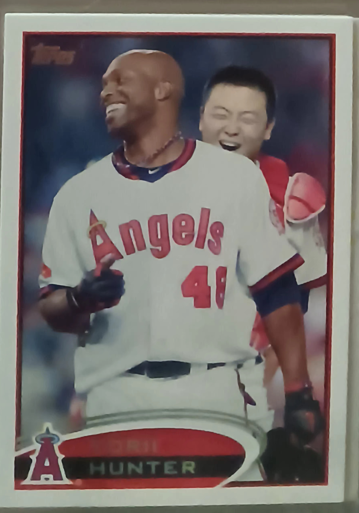</a></td>
  <td align="center"></td>
  <td align="center"><a href="./CardSmith-Public-Gallery/3e4189482dadf99f9e95c761e950a60c14e7d890fe7d3deefb8b03a4c70a008c.jpg">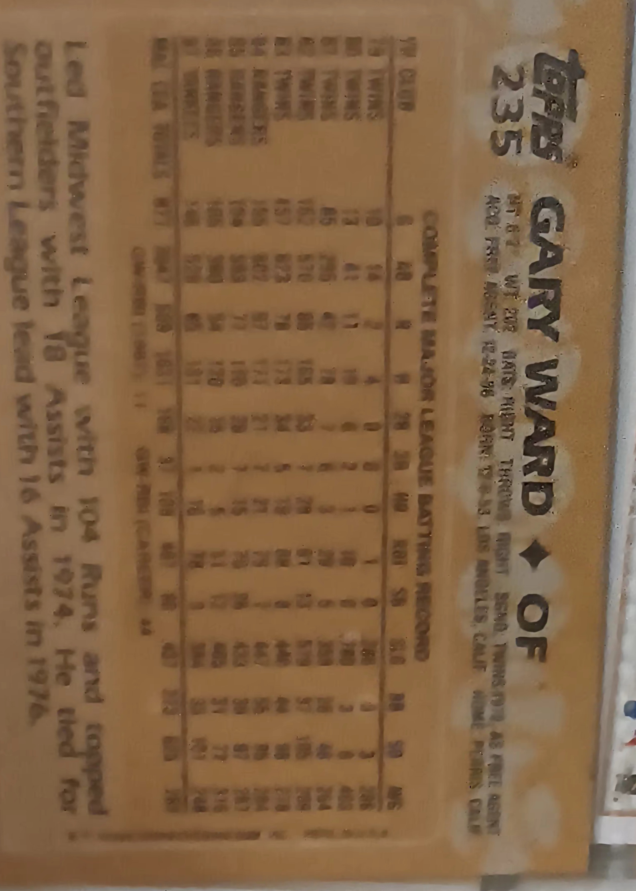</a></td>
  <td align="center"><a href="./CardSmith-Public-Gallery/42e70e2949f51e0e171557a4cb2e13c5d066fd66a0477b01b5c04132481a63af.jpg">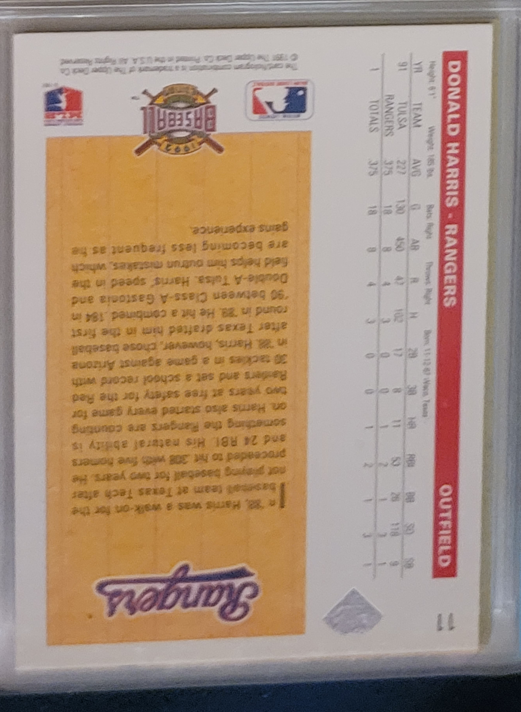</a></td>
</tr>
<tr>
  <td align="center"></td>
  <td align="center"></td>
  <td align="center"><a href="./CardSmith-Public-Gallery/4b6ab444a25487acc5153ea90014be90bea52e1aaaa777ad7746179e76fce0a0.jpg">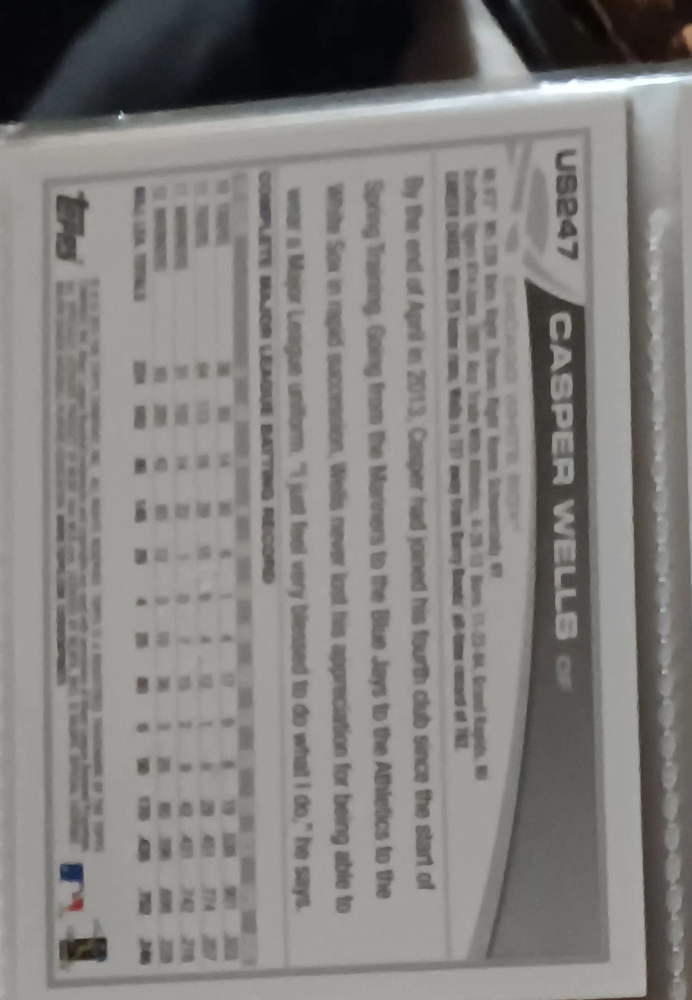</a></td>
  <td align="center"><a href="./CardSmith-Public-Gallery/64a242cefa9f5efe33bd87171f0a97fed0d5e2d74394d1ebd5759a5072514f2e.jpg">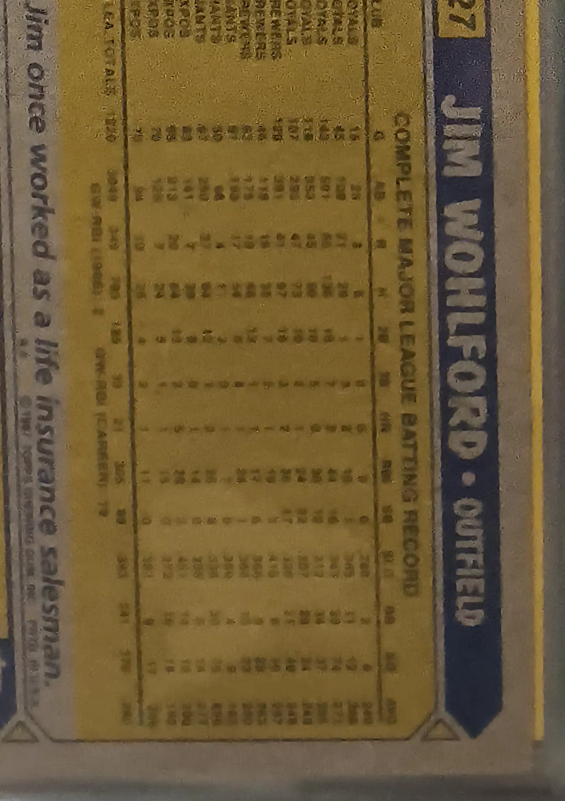</a></td>
</tr>
<tr>
  <td align="center"></td>
  <td align="center"></td>
  <td align="center"></td>
  <td align="center"></td>
</tr>
<tr>
  <td align="center"><a href="./CardSmith-Public-Gallery/9c55bd255782e94885a36763e179b623116e7308993a4029f56036648a48789f.jpg">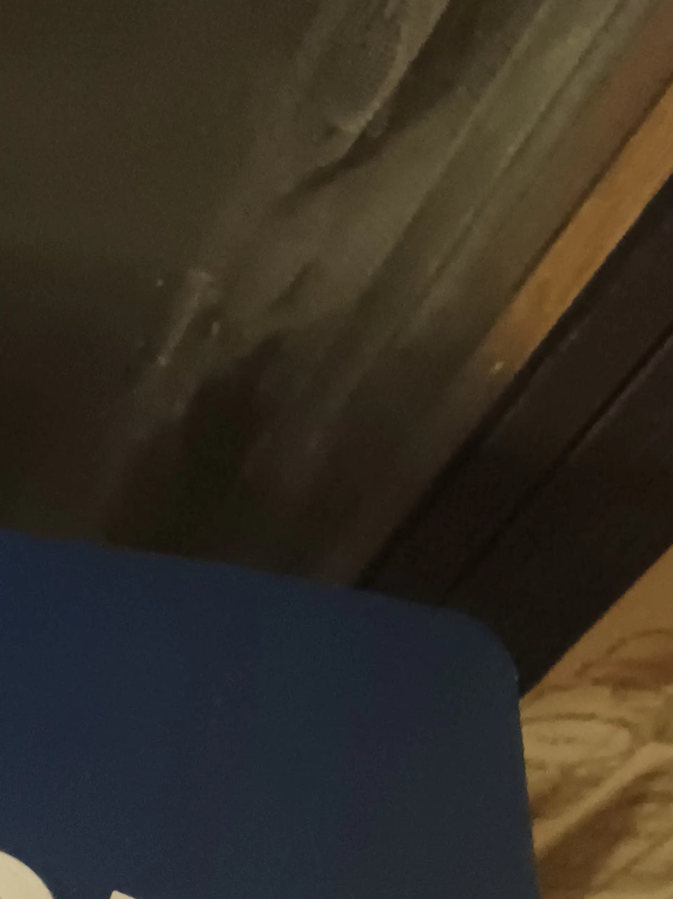</a></td>
  <td align="center"><a href="./CardSmith-Public-Gallery/beabdcf7f275a953a010a34ad7167a1cf9d4fe3afbba811029e89d3e93903e5e.jpg">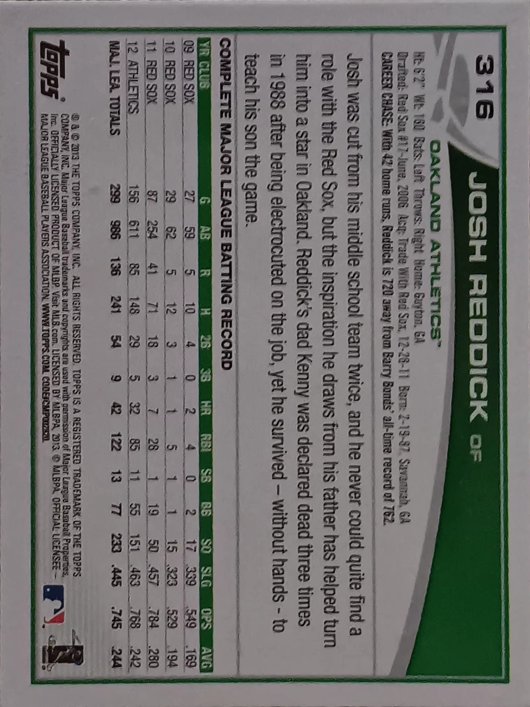</a></td>
  <td align="center"></td>
  <td align="center"><a href="./CardSmith-Public-Gallery/ca3b697e6211a09da9ca42a2b955cfebc8286819b36dc25e2007f52abb1c7bba.jpg">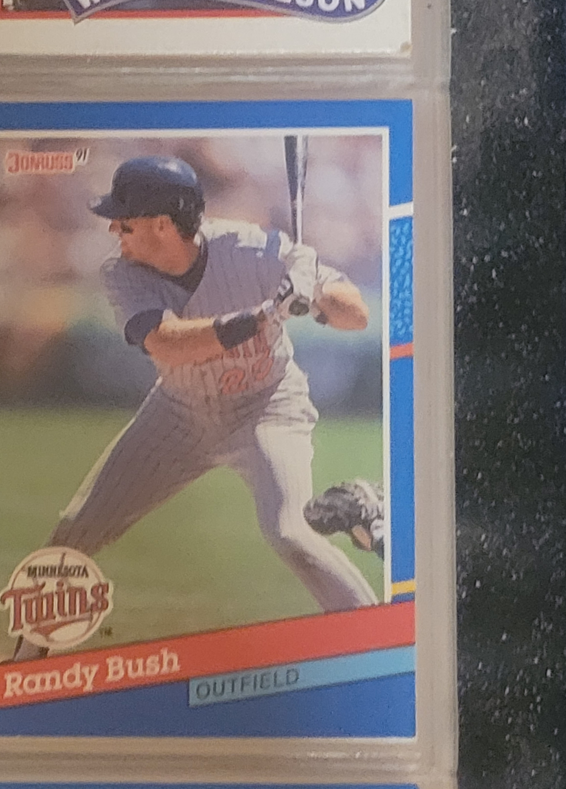</a></td>
</tr>
<tr>
  <td align="center"></td>
  <td align="center"><a href="./CardSmith-Public-Gallery/d7ca87497c9b26cc4428092305a315876dbafff71bb69c51f86082415daef94d.jpg">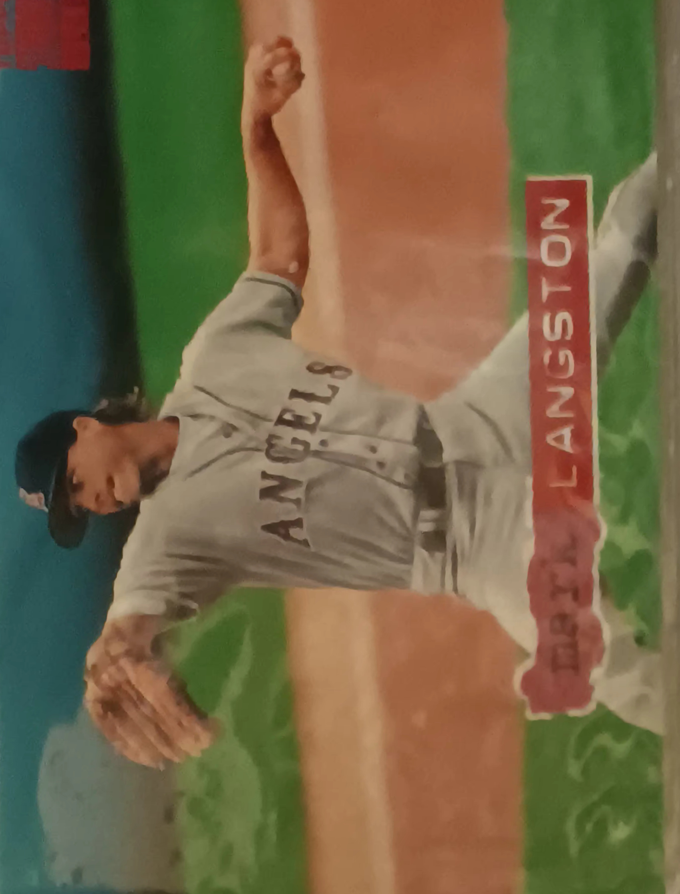</a></td>
  <td align="center"></td>
  <td align="center"><a href="./CardSmith-Public-Gallery/d930593e6c055501dcc96cda0aa934064e904259c843f1cef9340d08edef3e41.jpg">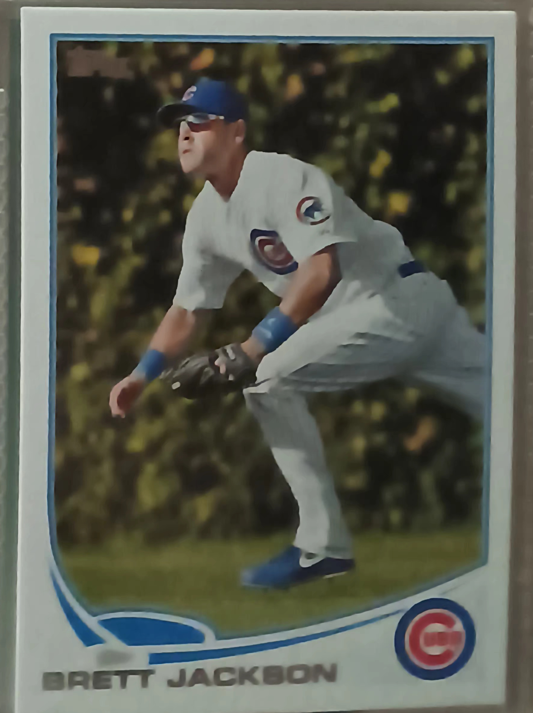</a></td>
</tr>
<tr>
  <td align="center"></td>
  <td align="center"></td>
  <td align="center"><a href="./CardSmith-Public-Gallery/e963b28f45e19a88be91be1c14599a6194f57f932019f9e65f5ddf1fa5bcea0d.jpg">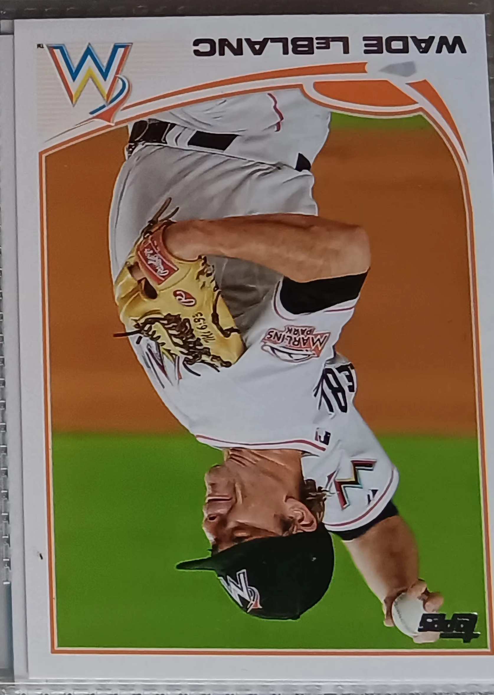</a></td>
  <td align="center"><a href="./CardSmith-Public-Gallery/ea1fa9a30df8959509707940d1a1d92eb86b538f3d1a8ef59297b78a9c5e8b79.jpg">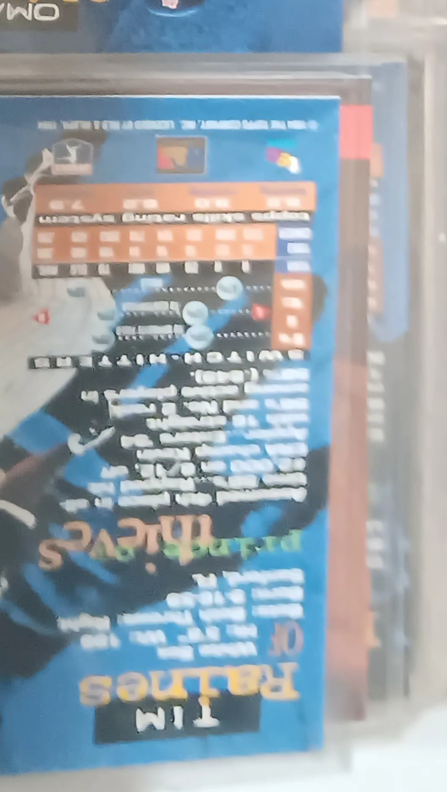</a></td>
</tr>
<tr>
  <td align="center"></td>
  <td align="center"></td>
  <td align="center"></td>
  <td align="center"></td>
</tr>
</table>

**Want to see more?** I've put together a larger collection of 289 original-quality images for anyone interested in looking through more of the results. I'm keeping it as a separate ZIP (about 474 MiB) so you don't have to scroll through hundreds of pictures here.

[Extended image collection — GitHub Releases](https://github.com/tiddy-tickler/CardSmith/releases)

The ZIP is prepared and awaiting upload. It's a collection of real development results, not an application installer.

## What I'm working toward

| Priority | Goal |
| --- | --- |
| 1 | Better card detection, cropping and orientation on real photos. |
| 2 | More accurate front/back pairing, OCR and exact card identification. |
| 3 | Faster processing with less manual work on large collections. |
| 4 | Better inventory editing, recovery, exports and installation. |
| 5 | Get a Windows beta properly tested and expand hardware and platform testing. |
| 6 | Support more card categories and permitted reference and pricing services. |

My long-term speed target is around 10,000 cards in eight hours on suitable hardware. For accuracy, the minimum goals are at least 90% of representative crop tests reaching 90% overlap and 95% correct exact-printing identification among automatically confirmed cards, with at least 90% coverage. I haven't reached those targets on independent representative tests yet.

I'd rather have the app leave a price blank than make up a number. Zero incorrect numeric valuations is the goal.

## Get involved

If you collect, buy or sell cards, I'd like to hear what would actually make this useful for you. Suggestions, feedback and interest in testing are welcome.

- [Leave feedback or suggest a feature](https://github.com/tiddy-tickler/CardSmith/issues/new)
- [Follow the project](https://github.com/tiddy-tickler/CardSmith)

Please keep private collection information, credentials, unredacted logs and copyrighted datasets out of public issues. Test builds will be shared separately with approved testers; I don't have a public download or release date to announce yet.

## Supporting the project

I'm developing CardSmith independently. If you like the idea and want to help, sharing it, giving feedback or offering technical help all count. Financial support is entirely optional.

**[Support CardSmith on GoFundMe](https://gofund.me/729fbb185)**

## A quick note

I'm keeping the application source, internal development material and private test data separate from this showcase. This page doesn't grant a software license or permission to distribute the application.

CardSmith is meant to help identify and appraise cards, not replace professional grading or guarantee what a card will sell for. It's an independent project and isn't affiliated with or endorsed by the card brands or publishers mentioned here.
